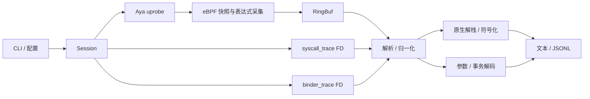

# amtracer 设计

状态：已确认方向，开始实现。日期：2026-11-24。

## 目标和边界

面向 Android AArch64 的进程追踪工具，使用 Rust 和 Aya。项目位于
`common/tools/amtracer`，是独立 Git 仓库；普通构建不依赖父内核源码树。

| 功能 | 事件来源 | 用户态工作 |
| --- | --- | --- |
| uprobe | Aya / eBPF / 标准 uprobe-perf 接口 | 地址解析、通用寄存器、表达式、内存输出、原生调用栈 |
| syscall | 现有 syscall_trace 驱动 | 参数解码、入口和返回关联、耗时、原生调用栈 |
| Binder | 现有 binder_trace 驱动 | 事务、结果、请求和回复关联、Parcel 数据展示 |

完整寄存器和内存表达式只用于 uprobe。syscall 和 Binder 不另建 eBPF 采集入口，
不因统一输出扩展两个驱动的寄存器 ABI。不新增 /dev 节点。
使用现有内核 UXN-uprobe 集成，工具不自行注册、激活 UXN，也不承诺任意匿名地址可挂载。

首个验证平台为 fuxi、Android 13、ARM64 Linux 5.15。用户态目标为
`aarch64-linux-android`，eBPF 目标为 `bpfel-unknown-none`。拒绝 AArch32 被追踪进程。

## 数据流



三路事件保留明确类型，通过 Rust 枚举处理。共享的是会话生命周期、目标进程信息、
ELF/maps 缓存、解栈、输出；不把三种不同的原始 ABI 合并成一个内核协议。

## 仓库结构

```text
crates/amtracer/       用户态 CLI 和业务模块
crates/amtracer-ebpf/  no_std 的 uprobe 采集程序
crates/amtracer-abi/   no_std 的 uprobe 配置、事件布局
xtask/                构建、UAPI 同步及验证入口
uapi/                 原样保存的驱动 UAPI、来源和哈希
tests/fixtures/       受控 native 和 Binder 测试程序
docs/                 设计、语法、实施记录、测试记录
```

用户态先按 target、uprobe、expr、ktools、syscall、binder、unwind、output 拆模块。
只在 std/no_std 与共享 ABI 边界拆 crate。优先使用具体类型，不为单一实现增加 trait、
Builder、插件注册器或多套传输抽象。

驱动绑定由固定版本的 UAPI 生成，保存源文件校验值和来源记录，提供显式同步命令。
更新协议应形成可审查的 diff；构建不自动读取或修改父内核。

## uprobe 定位

```sh
amtracer uprobe -p 1234 --probe 'libfoo.so+0x1234' --regs --stack
amtracer uprobe -p 1234 --probe 'libfoo.so+target_func' --stack
amtracer uprobe -p 1234 --probe 'libfoo.so+target_func+0x10'
amtracer uprobe -p 1234 --probe '0x7a12345678'
```

三种输入最终都归一化为原始文件 inode 与文件偏移。

* 库名加数值默认采用 ELF 虚拟地址语义。常见 ET_DYN 库的这个值对应反汇编地址。
  必须经 PT_LOAD 转换，不能直接当文件偏移。文件偏移使用独立明确选项。
* 符号使用 dynsym/symtab，转换 st_value，再加符号内偏移。IFUNC 不承诺自动解析实际实现。
* 绝对虚拟地址经目标 maps 找到映射，使用 mapping offset 与段信息校验文件位置。
* 使用不同的类型表示运行时 VA、ELF VA 和文件偏移，避免混算。
* 检查指令 4 字节对齐、文件范围、可执行段、数值溢出和 AArch64 ELF machine。
* 同名多个库必须列出候选，不能悄悄选择第一项；可以使用完整路径消歧。
* 不支持 APK 中直接映射的 so，目标需为可访问的独立 ELF 文件。
* deleted/memfd 仅在能够访问原始 backing inode 时支持。匿名/JIT 不支持标准 uprobe 挂载。
  解压到一个新文件不能替代原 inode。

一个通用 uprobe eBPF 程序配合 attach cookie 查找探针配置，优先使用当前 Aya 的单点
perf 挂载路径，不依赖高版本内核的 uprobe_multi。测试覆盖已有线程、后创建线程与跨 CPU。
eBPF 仍检查 TGID/TID 过滤，避免把挂载范围等同于业务过滤。

会话持有所有 link、程序和 FD。启动中途失败必须释放已安装探针。退出、Ctrl-C、
目标退出时清理；不默认 pin 到 bpffs。目标 exec 或映射变化时失效旧的解析和符号缓存，
绝对地址不得静默绑定到另一个新映射。动态库等待挂载应明示可能错过安装前的调用。

## uprobe 表达式

| 表达式 | 语义 |
| --- | --- |
| r13 或 x13 | x13 原值 |
| *r13 | x13 指向地址处的 u64 |
| *(r13 + 1B) | 地址加 1 字节，再读 u64 |
| *(r13 + 1W) | 地址加 2 字节，再读 u64 |
| *(r13 + 1D) | 地址加 4 字节，再读 u64 |
| *(r13 + 1Q) | 地址加 8 字节，再读 u64 |
| *(r13 + 1W):u16 | 地址加 2 字节，再读 u16 |
| **r13 | 两层指针读取 |
| cstr(x0, 128) | x0 所指地址，最多 128 字节字符串 |
| bytes(x1, 64) | x1 所指地址，64 字节 hex/ASCII |

B/W/D/Q 是偏移单位，不隐式改变读取宽度。默认解引用为 u64，类型后缀显式改变最后
一次标量读取宽度。首版支持 u8/u16/u32/u64、i8/i16/i32/i64。裸整数以字节计数；
带单位的数值采用十进制，十六进制不加单位，避免 0x10B 的歧义。

寄存器为 x0-x30、sp、pc、pstate；r0-r30 是相应 x 寄存器别名，r13 不是 SP。
支持括号、加减、负偏移和前缀解引用。首版无任意用户函数调用和无限循环。

用户态解析 AST，检查寄存器、类型、预算、溢出，编译成有界采集计划。BPF 内不解析文本。
拟定上限：每探针 16 个输出项，解引用深度 4，额外内存总量 4 KiB；由基准验证。
输出包含读取地址、宽度、有效长度和状态。标量读取失败不能显示为成功的零；字符串和
字节区分 fault、截断及实际长度。TBI/PAC 处理保留原始值，地址归一化必须验证映射，
不硬编码清除高 16 位。

所有内存读取在命中时尽力采集；其他线程仍可能并发修改内存，因此不声称全进程原子快照。
后续格式化不再从活进程读取内存补齐当时的结果。

## 事件与并发

uprobe 使用 BPF RingBuf。大块记录放 per-CPU 临时 map，不放 BPF 本地栈。
只输出初始化且有效的字节，记录固定宽度整数、版本、记录长度、cookie、时间、CPU、
TGID/TID 和状态，不传 Rust enum/usize/原生指针布局。

解析器校验版本、最小长度、偏移、数量及溢出，不直接引用不对齐的原始字节结构。
驱动每次 read 一条完整记录，处理 EAGAIN/EMSGSIZE，不能把记录当无边界字节流。
syscall.pid 与 binder.tgid 才是各自 TGID，适配层显式映射，避免 pid/tid 混用。

采集线程通过 epoll 消费三个入口，处理线程解栈、符号化和输出，中间为有界队列。
内核与用户态分别记录丢失。驱动 lost_before 是累计值，按变化量解释；退出另读 64 位统计。
时间使用单调时钟。跨来源 sequence 不能比较为全局顺序，接收顺序不等于因果关系。

## 原生调用栈

uprobe 与 syscall 共享 framehop 解栈器，使用捕获的 PC/SP/FP/LR 和栈窗口，
支持 DWARF CFI (.eh_frame/.debug_frame) 和 FP 回退。默认窗口 8 KiB，首版最大 16 KiB。
ELF、build-id、模块映射及符号缓存共享，提供外部符号目录，strip 后至少输出模块加偏移。

处理当前 PC 和返回地址的区别、函数序言/尾声、PAC、叶函数。显示明确的结束原因，
如正常结束、窗口不足、读失败、无展开信息、深度达到上限。只从快照读取栈，窗口之外停止。
首批验证无 FP 有 CFI、递归、PAC 和中间指令命中；Java/ART 栈不在首版承诺范围。
不自写完整 CFI 解释器，也不沿用现有 C 工具对外部 Android 构建树的链接依赖。

## syscall 驱动接入

PR_KTOOLS -> 控制 FD -> KT_IOC_OPEN_SYSCALL_TRACE -> 配置 -> START -> read/poll。
直接使用现有 v2 事件、参数 blob、用户栈，保持现有内核 ABI。

用户态提供 AArch64 syscall 名称表和常见参数解码，按同一 TID 关联 ENTER/EXIT，
检查 nr 和时间，输出返回值、errno、持续时间。缺 ENTER 的 EXIT 可单独输出，不伪造耗时。
丢失使相关配对失效；入口被替换、线程/进程退出、超时都必须有界清理。restart 返回值不能
伪装为最终用户 errno。退出缓冲区直接使用驱动按返回值和容量采集的数据。

现有 nofault 栈/参数读取失败会显式标记，工具如实展示。若以后需要改变采集行为，
先给出独立内核补丁方案确认，不在工具实施中顺手改动。

## Binder 驱动接入

使用 KT_IOC_OPEN_BINDER_TRACE 与现有 ABI v3。初始化先读 feature，按实际能力处理
outcome/error。展示 transaction_debug_id、reply_to_debug_id、code、flags、sender、
最多 256 字节数据、截断状态。按事务 ID 关联请求和回复，区分同步和 oneway。

SUBMITTED 只表示 Binder 接受事务，FAILED 的 error 可以为 0，不能用 error==0 判成功。
旧能力的 UNKNOWN 如实保留。Parcel 首版提供 raw hex 与经过长度、对齐、UTF-16 校验的
interface token 尽力解析，不承诺通用 AIDL 参数反序列化。

驱动按事件发生进程过滤，单 PID 不保证收到另一端的回复。双向关联必须显式扩大
采集范围，再在用户态筛选关联链。不能从内核 proc 指针推断目标 PID；现有事件没有
接收时间，不能输出服务执行耗时。捕获请求和回复时，仅标注两个采集点的时间差。

## CLI 和交付

基础命令为 doctor、uprobe、syscall、binder；后续 run --config 组合三路。输出文本或
JSONL，数据写 stdout/指定文件，诊断与丢失统计写 stderr。按需加载 Aya 或打开驱动，
纯 syscall/Binder 运行不要求加载 BPF。已有驱动会话被占用时报告 EBUSY，不接管。

README 与实施记录严格区分已实现、已编译、已真机验证、尚未完成；不把规划的命令当成
已支持命令。设计是目标，阶段实现可以缩小入口，但必须明确报告。

## 参考

* Aya: https://github.com/aya-rs/aya
* Aya UProbe: https://docs.rs/aya/latest/aya/programs/uprobe/struct.UProbe.html
* framehop: https://github.com/mstange/framehop
* stackplz: https://github.com/SeeFlowerX/stackplz/tree/dev
* RingBuf: https://docs.kernel.org/bpf/ringbuf.html
* Rust Android target: https://doc.rust-lang.org/rustc/platform-support/android.html

参考上游时记录版本与许可证；复制代码保留归属。原有 Go 引擎与多架构支持不迁入。
